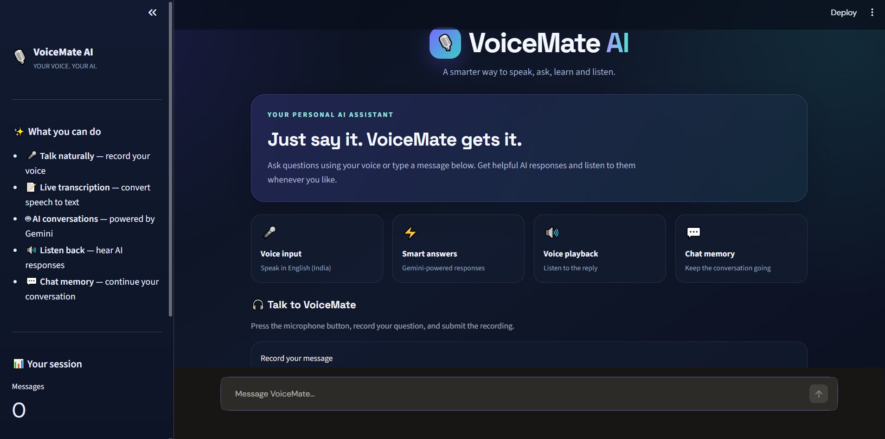
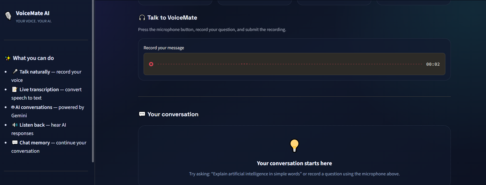
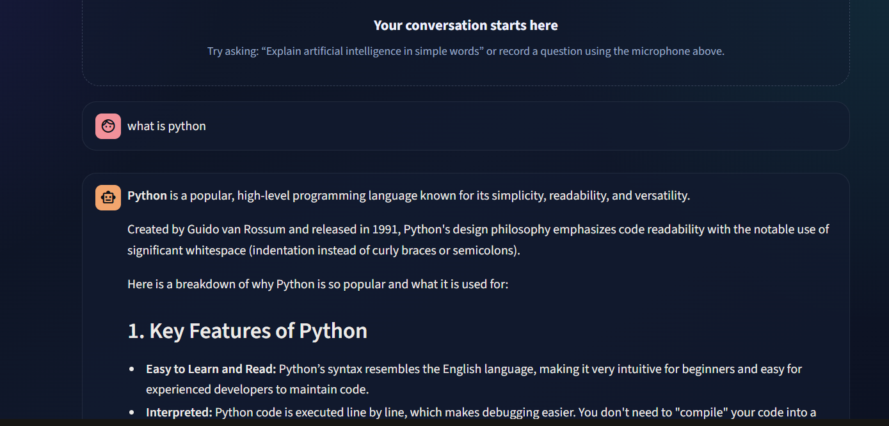
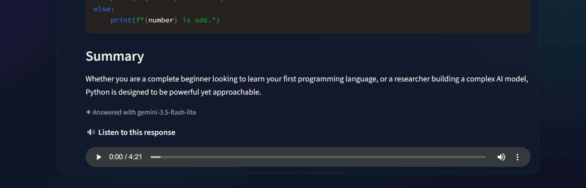

# 🎙️ VoiceMate AI – AI-Powered Voice Assistant

VoiceMate AI is an interactive AI-powered voice assistant built with Python and Streamlit. It allows users to communicate with an AI assistant using either voice or text, receive intelligent responses, and listen to AI-generated speech.

## ✨ Features

- 🎤 **Voice Input:** Record your voice and convert speech into text.
- 💬 **AI Chat Assistant:** Get intelligent responses powered by Google Gemini.
- 🔊 **Text-to-Speech:** Listen to AI responses using gTTS.
- 🧠 **Conversation Memory:** Maintains conversation context during the session.
- ⌨️ **Text Input:** Communicate with the assistant through text.
- 🎨 **Interactive UI:** Clean and user-friendly Streamlit interface.
- 🔄 **Model Fallback:** Attempts alternative Gemini models when one is unavailable.

## 🛠️ Technologies Used

- **Python** – Core programming language
- **Streamlit** – Interactive web application
- **Google Gemini API** – AI-powered response generation
- **SpeechRecognition** – Speech-to-text conversion
- **gTTS** – Text-to-speech generation
- **python-dotenv** – Environment variable management
## 📸 Screenshots

### 🏠 Home Screen


### 💬 Text Chat


### 🎤 Voice Input


### 🔊 Audio Response

## 📂 Project Structure

```text
VoiceMate-AI/
│
├── app.py
├── requirements.txt
├── .gitignore
└── README.md
```

## ⚙️ Installation & Setup

### 1. Clone the Repository

```bash
git clone https://github.com/21vicky/VoiceMate-AI.git
cd VoiceMate-AI
```

### 2. Create a Virtual Environment

```bash
python -m venv venv
```

Activate it on Windows:

```bash
venv\Scripts\activate
```

### 3. Install Dependencies

```bash
pip install -r requirements.txt
```

### 4. Configure Gemini API Key

Create a `.env` file in the project root:

```env
GEMINI_API_KEY=your_gemini_api_key
```

Get your API key from [Google AI Studio](https://aistudio.google.com/).

### 5. Run the Application

```bash
streamlit run app.py
```

The application will open in your browser.

## 🚀 How It Works

1. Open the VoiceMate AI application.
2. Enter a question using text or record your voice.
3. Voice input is converted into text.
4. The Gemini API processes the request.
5. The AI generates a response.
6. gTTS converts the response into speech.
7. Continue the conversation with session-based context.

## 🔐 Security

- API keys are stored in environment variables.
- `.env` files are excluded using `.gitignore`.
- Never upload your Gemini API key to GitHub.

## 🎯 Project Goal

This project demonstrates practical implementation of Generative AI, speech recognition, text-to-speech technology, API integration, and interactive application development using Python.

## 👨‍💻 Developer

**Vignesh U**

- GitHub: [@21vicky](https://github.com/21vicky)
- Project: [VoiceMate AI](https://github.com/21vicky/VoiceMate-AI)

---

⭐ If you find this project interesting, consider giving it a star!         